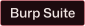

<picture>
  <source media="(prefers-color-scheme: dark)" srcset="https://raw.githubusercontent.com/Frraz/Frraz/main/assets/banner-rubro.svg">
  <source media="(prefers-color-scheme: light)" srcset="https://raw.githubusercontent.com/Frraz/Frraz/main/assets/banner-claro.svg">
  
</picture>

### Acho o sinal no meio do ruído.

Monitoro uma rede de fibra óptica em um provedor de internet. Passo o dia entre as métricas do Zabbix e do Grafana, procurando a anomalia que importa ou o motivo de uma ONU ter parado de autenticar. Em paralelo, estudo para proteger redes como essa.

Me encontre em [warley.ferzion.com.br](https://warley.ferzion.com.br), no [LinkedIn](https://www.linkedin.com/in/warley-ferraz-almeida/) ou por [e-mail](mailto:warley.ferraz.wf@gmail.com).

## Agora

- **No NOC da Linknet,** de casa, diagnosticando incidentes em redes GPON/FTTH.
- **Na FIAP,** cursando Segurança Cibernética até 2028, do fundamento para cima.
- **Nos meus servidores,** mantendo sistemas próprios em VPS Linux, com Nginx, Docker, backup e deploy em Bash com healthcheck e rollback.
- **Em laboratórios,** treinando no Hack The Box, no TryHackMe e na PortSwigger Academy.

## O caminho até aqui

Não cheguei em linha reta.

```console
$ traceroute noc
 1  varejo
 2  suporte em provedor de internet
 3  frente de caixa, com apoio temporário ao CPD
 4  agronegócio e crédito rural
 5  noc, analista de redes n2
```

## Ferramentas

Separadas pela origem do que sei: quanto mais forte o vermelho, mais perto do trabalho real.

**No trabalho**


**Nos meus servidores**


**Em laboratório e estudo**





Nunca trabalhei em cargo de segurança, SOC ou pentest. Busco a minha primeira oportunidade na área.

## Contribuições

Quase tudo o que faço fica em repositórios privados, mas a cobra não perdoa nenhum dia.

<picture>
  <source media="(prefers-color-scheme: dark)" srcset="https://raw.githubusercontent.com/Frraz/Frraz/output/github-contribution-grid-snake-dark.svg">
  <source media="(prefers-color-scheme: light)" srcset="https://raw.githubusercontent.com/Frraz/Frraz/output/github-contribution-grid-snake.svg">
  
</picture>

## Vamos conversar

Procuro função técnica em redes, NOC, infraestrutura Linux, DevOps, DevSecOps ou segurança, de preferência remota. Se a sua equipe tem uma vaga assim, [me escreva](mailto:warley.ferraz.wf@gmail.com).

Se estiver só de passagem, [meu site](https://warley.ferzion.com.br) tem um terminal e nove selos escondidos. Quem reúne todos libera um tema que começa bloqueado.
