<picture>
  <source media="(prefers-color-scheme: dark)" srcset="https://raw.githubusercontent.com/Frraz/Frraz/main/assets/banner-rubro.svg">
  <source media="(prefers-color-scheme: light)" srcset="https://raw.githubusercontent.com/Frraz/Frraz/main/assets/banner-claro.svg">
  
</picture>

### Analista de Redes N2 em NOC. Coloco sistemas em produção em Linux e respondo por eles depois do deploy.

Trabalho no NOC de um provedor de fibra óptica. Fora dele, desenvolvo sistemas de gestão para clientes e cuido do que vem depois do código: servidor, deploy, backup e monitoramento. Estudo Segurança Cibernética na FIAP para proteger a infraestrutura que já opero.

**Procuro vaga técnica remota em infraestrutura Linux, NOC e redes ou DevOps. [Me escreva](mailto:warley.ferraz.wf@gmail.com).**<br>
Também estou no [LinkedIn](https://www.linkedin.com/in/warley-ferraz-almeida/) e em [warley.ferzion.com.br](https://warley.ferzion.com.br).

## O que eu faço

**No NOC da Linknet, desde agosto de 2026.** Acompanho alarmes e gráficos no Zabbix e no Grafana e diagnostico sinal, status e autenticação de ONUs e ONTs em redes GPON/FTTH. Provisiono ONUs e configuro roteadores de assinantes por plataforma ACS. Registro os incidentes no IXC Provedor. Trabalho de casa.

**Em produção, desde novembro de 2025.** Desenvolvo sob encomenda sistemas de gestão para o agronegócio, em Python e Django com PostgreSQL, e opero os servidores Ubuntu onde eles rodam:

- Stacks em Docker Compose com aplicação, workers, PostgreSQL e Redis, atrás do Nginx com HTTPS (Let's Encrypt e HSTS).
- Deploy automatizado em Bash com backup prévio, build, migrações, healthcheck e rollback automático.
- Firewall UFW liberando só SSH, HTTP e HTTPS, SSH só por chave, e PostgreSQL e Redis sem porta publicada.
- Backup com pg_dump e restauração testada, com procedimento documentado.
- CI no GitHub Actions com testes automatizados e checagem de migrações pendentes.

**Karasoku, minha plataforma de observabilidade, no ar desde novembro de 2026.** Ela acompanha 3 servidores e 11 aplicações. Agentes Grafana Alloy enviam métricas ao VictoriaMetrics e logs ao Loki por uma rede privada WireGuard. Sondas HTTP/TLS testam cada aplicação, o Alertmanager avisa no Telegram, e cada alerta tem um runbook.

## Ferramentas, pela origem

| Origem | Ferramentas |
|---|---|
| **No trabalho** | GPON/FTTH, ONUs e ONTs, plataformas ACS, Zabbix, Grafana, IXC Provedor |
| **Em produção** | Ubuntu Server, Bash, SSH, systemd, Nginx, Gunicorn, Docker Compose, UFW, Let's Encrypt, PostgreSQL, Redis, Celery, GitHub Actions, Python, Django, Django REST Framework, pytest, HTMX |
| **Observabilidade** | Grafana Alloy, WireGuard, VictoriaMetrics, Loki, Alertmanager, Grafana |
| **Formação e laboratório** | OWASP Top 10, CWE, MITRE ATT&CK, LGPD, Kali Linux, Nmap, Wireshark, Burp Suite, Hack The Box, TryHackMe |

Nunca trabalhei em cargo de segurança, SOC ou pentest. A última linha da tabela é estudo, não experiência profissional.

## Formação

- **Tecnólogo em Segurança Cibernética**, FIAP, 2026 a 2028, em andamento
- **Pós-graduação em Engenharia DevOps**, Faculdade Focus, concluída em 2025, 420 h
- **Tecnólogo em Análise e Desenvolvimento de Sistemas**, UNIASSELVI, concluído em 2025
- **Google Cybersecurity Certificate**, em andamento: 5 de 9 cursos concluídos em novembro de 2026
- **Inglês** para leitura de documentação técnica

## O caminho até aqui

```console
$ traceroute noc
 1  jovem aprendiz e varejo                         2020–2022
 2  suporte n1 em provedor de internet              2022–2023
 3  frente de caixa, com apoio temporário ao CPD    2023–2024
 4  administrativo no agronegócio e crédito rural   2024–2026
 5  noc, analista de redes n2                       2026
```

## Contribuições

O código dos sistemas de clientes fica em repositórios privados, e o gráfico conta essas contribuições sem mostrar o conteúdo.

<picture>
  <source media="(prefers-color-scheme: dark)" srcset="https://raw.githubusercontent.com/Frraz/Frraz/output/github-contribution-grid-snake-dark.svg">
  <source media="(prefers-color-scheme: light)" srcset="https://raw.githubusercontent.com/Frraz/Frraz/output/github-contribution-grid-snake.svg">
  
</picture>

## Vamos conversar

Procuro vaga remota em infraestrutura Linux e sustentação, NOC e redes ou DevOps. Para entrar em segurança, aceito começar por estágio. Aceito CLT, PJ e escala de turnos. **[Me escreva por e-mail](mailto:warley.ferraz.wf@gmail.com)** ou pelo [LinkedIn](https://www.linkedin.com/in/warley-ferraz-almeida/).

Se estiver só de passagem, [meu site](https://warley.ferzion.com.br) tem um terminal e nove selos escondidos. Quem reúne todos libera um tema que começa bloqueado.

<!-- Revisado em 2026-11-19 a partir de curriculo/curriculo_mestre.md. Revisar quando: mudar de emprego, concluir o certificado do Google, publicar o repositório do Karasoku ou de um projeto de cliente, mudar o foco da busca. -->
