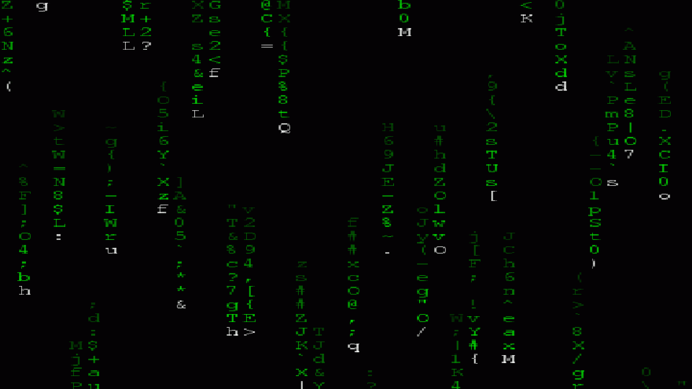

<!--
  ╔══════════════════════════════════════════════════════════╗
  ║   GitHub Profile — Warley Ferraz · Fundador @ Ferzion     ║
  ║   Identidade visual alinhada à marca Ferzion              ║
  ║                                                           ║
  ║   Mint : #52C795  #8AE3BA          verde da marca         ║
  ║   Ink  : #15201A  #1E2B23  #0E140F verde-floresta / fundo ║
  ║   Bone : #F1EADB  #E3DBC9          creme / texto claro    ║
  ║   Mute : #9DAC9E  #5E6457          tons neutros           ║
  ╚══════════════════════════════════════════════════════════╝
-->

<!-- ░░░░░░░░░░░░░░░░░░░░░░  BANNER  ░░░░░░░░░░░░░░░░░░░░░░ -->
<div align="center">
  <a href="https://github.com/Frraz">
    
  </a>
</div>

<br>

<!-- ░░░░░░░░░░░░░░░░░░░░  TYPING SVG  ░░░░░░░░░░░░░░░░░░░░ -->
<div align="center">
  
</div>

<br>

<!-- ░░░░░░░░░░░░░░░░░░░░  TÍTULO  ░░░░░░░░░░░░░░░░░░░░░░░░ -->
<div align="center">

  

  <br><br>

  

  <br>

  

  <br><br>

  <!-- Social Row -->
  <a href="https://warley.dev.ferzion.com.br/">
    
  </a>
  <a href="https://www.linkedin.com/in/warley-ferraz-almeida-280a55185/">
    
  </a>
  <a href="mailto:warley.ferraz.wf@gmail.com">
    
  </a>
  <a href="https://wa.me/5594992083253">
    
  </a>
  <a href="https://www.instagram.com/ferraz.____/">
    
  </a>

</div>

<br>

---

## `$ whoami`

```yaml
nome      : Warley Ferraz
papel     : Fundador & Desenvolvedor @ Ferzion
local     : Rondon do Pará — Pará, Brasil
fazendo   : Software sob medida para operações reais
estudando : Cybersecurity @ FIAP
```

- 🟢 &nbsp;Fundei a **[Ferzion](https://ferzion.com.br/)** para resolver um problema concreto: operações que crescem, mas continuam reféns de planilhas e processos manuais.
- 🛠️ &nbsp;Desenvolvo de ponta a ponta — **Django/DRF**, **PostgreSQL**, **Docker** e **CI/CD** — priorizando rastreabilidade, integridade de dados e o que se pode auditar.
- 🔐 &nbsp;Curso **Cybersecurity na FIAP** porque segurança não é uma camada extra: nasce junto com a arquitetura.
- 🎓 &nbsp;Pós-graduado em **Engenharia DevOps** e graduado em **ADS** — base sólida entre desenvolvimento e infraestrutura.
- 📍 &nbsp;Construindo software sério a partir do interior do Pará — e provando que lugar nenhum é limite.

---

## `$ cd ~/ferzion`

<div align="center">

### 🏢 &nbsp;Ferzion — software sob medida para operações com propósito

<a href="https://ferzion.com.br/">
  
</a>
&nbsp;
<a href="https://www.linkedin.com/company/ferzion/">
  
</a>
&nbsp;
<a href="https://www.instagram.com/ferzion.dev/">
  
</a>

</div>

> A Ferzion **não vende software de prateleira**. A gente mapeia a operação primeiro —
> diagnóstico, processos e gargalos — e só então constrói o sistema que aquela operação realmente precisa.

**O que entregamos** — sistemas sob medida para **agronegócio**, **logística**, **gestão operacional** e **RH / folha de pagamento**, com integrações automatizadas (Power BI), trilhas de auditoria imutáveis e arquitetura que escala junto com o cliente.

<div align="center">


`Python` &nbsp;·&nbsp; `Django` &nbsp;·&nbsp; `PostgreSQL` &nbsp;·&nbsp; `Docker` &nbsp;·&nbsp; `HTMX` &nbsp;·&nbsp; `Tailwind`

</div>

---

## `$ ls ~/stack`

<div align="center">

**⟨ Linguagens ⟩**


**⟨ Frameworks & Libs ⟩**


**⟨ Banco de Dados & Cache ⟩**


**⟨ DevOps & Cloud ⟩**


</div>

---

## `$ ls ~/projetos`

<table width="100%">
<tr>

<td width="50%" valign="top">

### 🌐 &nbsp;Portfólio Pessoal
[](https://warley.dev.ferzion.com.br/)
[](https://github.com/Frraz/Portfolio)

Site profissional com blog, showcase de projetos e landing pages. Arquitetura desacoplada: **Next.js 14** no frontend e **Django REST Framework** servindo a API.


</td>

<td width="50%" valign="top">

### 🐄 &nbsp;Gestão de Rebanhos
[](https://rebanho.ferzion.com.br/)
[](https://github.com/Frraz/Rebanho)
[](https://github.com/Frraz/Rebanho/actions)

Rastreabilidade bovina com padrão **Ledger + Snapshot**, operações atômicas transacionais, saldo nunca negativo e deploy automático via GitHub Actions.


</td>
</tr>

<tr>

<td width="50%" valign="top">

### 🐂 &nbsp;ConfTech — Confinamento Bovino
[](https://conftech.ferzion.com.br/)
[](https://github.com/Frraz/ConfTech)

Gestão de lotes, currais, alocações e dietas. Endpoints **JSON para Power BI** com autenticação Bearer, GMD esperado e valor previsto por arroba.


</td>

<td width="50%" valign="top">

### ⏰ &nbsp;OnTime — Ponto Eletrônico
[](https://github.com/Frraz/OnTime)
[](#)

Controle de jornada com **validação GPS/IP inteligente**, banco de horas automático, auditoria completa e fechamento semanal via Celery. Atende de 10 a 500+ funcionários.


</td>
</tr>

<tr>

<td width="50%" valign="top">

### 🌲 &nbsp;Romaneio de Madeiras
[](https://github.com/Frraz/MadeireiraJD)

Substitui planilhas por um sistema web centralizado: romaneios de vendas, saldo automático por cliente (100% rastreável), relatórios financeiros e exportação CSV/XLSX/PDF.


</td>

<td width="50%" valign="top">

### 🗺️ &nbsp;Gerador de KML
[](https://github.com/Frraz/Gerador-de-KML)

API REST + CLI para geração automatizada de arquivos KML. Validação de coordenadas geoespaciais e exportação otimizada para Google Earth e ferramentas GIS.


</td>
</tr>
</table>

---

## `$ cat ~/formacao`

```yaml
graduação : ADS — Análise e Desenvolvimento de Sistemas   ·  UNIASSELVI       ✅
pós       : Engenharia DevOps                              ·  Faculdade Focus  ✅
cursando  : Graduação em Cybersecurity                     ·  FIAP             🔐
```

**Aprofundando agora** &nbsp;·&nbsp; Cybersecurity & AppSec &nbsp;·&nbsp; Django avançado e performance &nbsp;·&nbsp; Clean Architecture em Python &nbsp;·&nbsp; TDD e estratégias de teste

---

## `$ git log --activity`

<div align="center">

[](https://github.com/Frraz)

<br>


<br><br>


<br><br>

<!-- Snake Animation — gerada pela GitHub Action em .github/workflows/snake.yml -->
<!-- <picture>
  <source media="(prefers-color-scheme: dark)" srcset="https://raw.githubusercontent.com/Frraz/Frraz/output/github-contribution-grid-snake-dark.svg" />
  <source media="(prefers-color-scheme: light)" srcset="https://raw.githubusercontent.com/Frraz/Frraz/output/github-contribution-grid-snake.svg" />
  
</picture> -->

</div>

---

## `$ ./contato.sh`

<div align="center">

**⟨ Pessoal ⟩**

<a href="https://warley.dev.ferzion.com.br/">
  
</a>
&nbsp;
<a href="https://www.linkedin.com/in/warley-ferraz-almeida-280a55185/">
  
</a>
&nbsp;
<a href="mailto:warley.ferraz.wf@gmail.com">
  
</a>
&nbsp;
<a href="https://wa.me/5594992083253">
  
</a>

<br><br>

**⟨ Ferzion ⟩**

<a href="https://ferzion.com.br/">
  
</a>
&nbsp;
<a href="https://www.linkedin.com/company/ferzion/">
  
</a>
&nbsp;
<a href="https://www.instagram.com/ferzion.dev/">
  
</a>

<br><br>

```
> Tem uma operação que ainda depende de planilha? Bora conversar.
> Aberto a projetos sob medida, parcerias e colaborações técnicas. 🚀
```

<br>

<sub>📌 README alinhado à identidade da Ferzion &nbsp;·&nbsp; Rondon do Pará — PA, Brasil &nbsp;·&nbsp; feito com Django e café ☕</sub>

</div>
